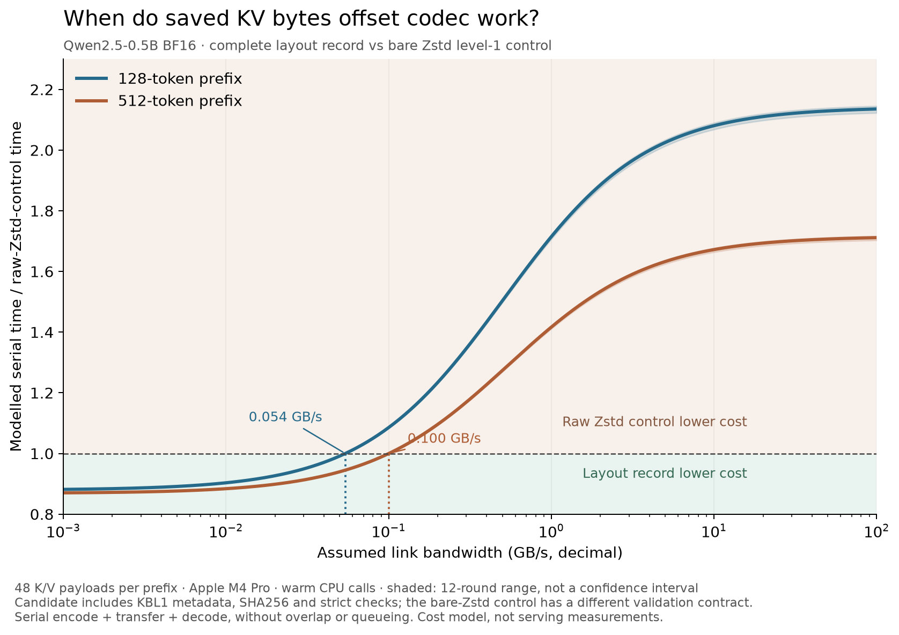

# KVBytePack

**When do smaller KV records pay for their codec cost?**

KVBytePack studies how byte layout changes the cost of storing and moving
inference state. It combines byte-exact tensor codecs with public measurements
of complete record size, encode/decode time and per-thread memory. The goal is
to make the tradeoff measurable on your system.

[CPU entry](#try-it-without-a-gpu) · [Real KV records](#start-with-the-real-kv-records) ·
[Cost model](#decide-whether-compression-pays) · [AIBrix contract study](docs/aibrix-layout.md)

KV tensors carry structure across channels and byte planes. Rearranging those
bytes can help a general-purpose codec; reversing the permutation restores the
supplied representation, including NaN payloads and signed zero. The codec does
not select or discard tokens.

Formerly **mynotwo/kvzip**. This project is independent of
[SNU's KVzip](https://github.com/snu-mllab/KVzip), which studies KV-cache eviction.
Existing `kvzip` imports and blob formats remain compatible.
See [migration and reproduction](docs/reproduce.md).

## What to measure

| Question | Evidence in this repository |
|---|---|
| Are the supplied tensor bytes preserved? | A weight-free CPU check, tensor APIs and before/after wire hashes |
| Does a smaller payload also mean a smaller stored record? | Real BF16 records with metadata, framing and integrity overhead included |
| Do saved bytes justify CPU and memory costs? | Matched raw-Zstd controls, encode/decode samples and per-thread memory observations |

The real-record study uses one small model and overlapping prefixes. It shows
both savings and their costs: smaller records still require more CPU than the
matched raw-Zstd control. These are component measurements, not a serving-speed
or whole-model-equivalence result.

## Try it without a GPU

Python 3.9+. No model weights, PyTorch, credentials or GPU required:

```bash
git clone https://github.com/mynotwo/kvbytepack.git
cd kvbytepack
python -m venv .venv
source .venv/bin/activate
python -m pip install .
python -m kvbytepack
```

Expected: a JSON record with `byte_exact: true`, `checks: 8`, and fixture SHA256
`f097ddb619e8f3f09aae9f836e858bff1e948b647a9a6c2075526e1cb2a412b3`.
This checks synthetic bit patterns; it does not measure model compression or speed.
Install from this repository or a release wheel; no PyPI publication is implied.

```python
import numpy as np
from kvbytepack import zip_tensor, unzip_tensor

x = np.arange(1024, dtype=np.float32).reshape(32, 32)
blob = zip_tensor(x, method="pipeline_zstd-1")
y = unzip_tensor(blob)
assert y.dtype == x.dtype and y.shape == x.shape
assert y.tobytes() == x.tobytes()
```

NumPy arrays and PyTorch tensors are supported; PyTorch is optional and needed
only for PyTorch inputs. Decoding a PyTorch-origin blob returns a CPU tensor.
The high-level blob stores method, shape and dtype. The low-level
`encode(raw, S, D, bpe, method)` / `decode(...)` API requires those parameters
from the caller. Neither API is a streaming or random-access storage format.

## Start with the real KV records

The repository includes the original **96 Qwen2.5-0.5B BF16 K/V payloads**:
all 24 layers at overlapping 128/512-token prefixes of one public CPython file.
You can inspect the bytes and measurements without loading a model.

For this record study, use Python 3.12 and the measured codec versions:

```bash
python -m pip install -e . numpy==2.5.4 zstandard==0.25.0
python bench/compare_cpu.py --check results/cpu_decode
```

The check verifies all 9,216 published before/after measurement rows against the
original payloads, encoded hashes, timing samples and aggregation. It reports
whether the current decoder uses the optional C kernel or NumPy fallback; it
does not rerun historical timings. No PyTorch, model weights or GPU is needed.

- [Original payloads and provenance](results/aibrix_layout/model_capture)
- [Complete-record size and AIBrix interface study](docs/aibrix-layout.md)
- [Current decode study, timing protocol and memory accounting](docs/cpu-decode.md)
- [All paired samples, controls and source/binary hashes](results/cpu_decode)

The optional C inverse reduces layout reconstruction cost; a compiler is needed
for that path, while NumPy remains the installation and correctness fallback.
[The guide](docs/cpu-decode.md#install-and-reproduce-without-a-gpu) separates
building the kernel, verifying stored results and rerunning timings.

## Decide whether compression pays

Choose a baseline first: uncompressed bytes or a matched codec such as raw
Zstd at the same level. Include the entire stored record and all added CPU work.
For one serial, non-overlapped transfer, a necessary condition is:

```text
(baseline_stored_bytes - candidate_stored_bytes) / bandwidth
    > candidate_encode_decode_time - baseline_encode_decode_time
```

Use bytes, bytes/second and seconds consistently. This condition does not model
queueing, overlap, concurrency, or the rest of a serving request. A smaller
compressed payload alone cannot establish a faster system.



In this model, median round break-even bandwidths are about **0.054 / 0.100 GB/s**
for the 128/512-token prefixes. Above those thresholds, the extra CPU cost
outweighs the stored-byte savings on this measured CPU. The shaded bands span
the twelve rounds; they are not confidence intervals or network measurements.
The control is a bare Zstd frame; the candidate includes KBL1 metadata, SHA256
and strict checks. Their validation contracts differ, so this comparison is not
a feature-matched production recommendation.
[Derived inputs and assumptions](results/cost_model) ·
[Vector figure](docs/assets/kv-cost-tradeoff.svg)

Recompute the model exports from the published timing rows with Python's
standard library. Only redrawing the PNG/SVG needs the optional Matplotlib tool:

```bash
python3 bench/plot_cost_tradeoff.py --check
# Optional figure redraw in an environment with matplotlib installed:
python bench/plot_cost_tradeoff.py --plot
```

For your own data, start with `zip_tensor` / `unzip_tensor` above, verify
`tobytes()` equality, then measure complete blob size and both codec phases
against your chosen baseline. [Capture instructions](docs/reproduce.md) cover
new model data. A useful reproduction reports dtype/layout, codec versions,
hardware, byte counts, timing protocol and a small public input if available.

## Read the implementation studies

- [Layout-pass fusion, v0.2.1](https://github.com/mynotwo/kvbytepack/blob/v0.2.1/docs/cpu-optimization.md)
- [Context reuse against v0.2.1](docs/cpu-context-reuse.md)
- [512-token decode against the context-reuse revision](docs/cpu-decode.md)

Each study identifies its own baseline. Their speedups should not be multiplied
into an end-to-end claim. Earlier data and negative observations remain public.

## Historical multi-model results

<details>
<summary>Inspect the 50-cell ratio archive and its limits</summary>

The repository includes a historical aggregate for Qwen2.5-7B and Qwen3-8B:
2 models × 5 context lengths (512–8192) × 5 input types = **50 cells**.
Each cell has 8 representations, 3 scopes (K, V, KV) and 15 methods.
Inputs repeat short paragraphs to fill context. They are **not independent
real-text documents**, and repetition can inflate compression ratios.

Recompute the exports using Python's standard library only:

```bash
python bench/export_results.py --check
python bench/summarize.py results/kv_aggregate_qwen.json
python bench/export_results.py --out-dir /tmp/kvbytepack-results
```

- [Original aggregate JSON](results/kv_aggregate_qwen.json)
- [18,000 ratios as CSV](results/measurements.csv)
- [Summary CSV](results/summary.csv)
- [Source hash, definitions and missing evidence](results/manifest.json)

Selected KV rows, medians over the same 50 cells:

| Representation | Raw zstd-1 | Byte split + zstd-1 | Channel-first + byte split + zstd-1 | Best of 15 methods |
|---|---:|---:|---:|---:|
| BF16 | 1.292× | 1.505× | 1.596× | 1.713× |
| FP16 | 1.314× | 1.563× | 1.575× | 1.752× |
| FP32 | 2.087× | 3.011× | 3.192× | 3.426× |

Ratio = uncompressed bytes / compressed **payload** bytes. Plane-length headers
are excluded in the historical aggregate; these are not total stored-blob ratios.
“Best” selects a method separately in each cell, then takes the median; it is
not a single deployable codec or a latency comparison. Higher is smaller payload.

BF16 and FP32 originate from a BF16 model representation; the runner widens to
FP32 for analysis. FP32 results therefore do not establish compression of
native FP32 model state. FP16, FP8 and integer conversions may lose information
before compression. Byte-exact codecs do not undo that conversion loss.

The archive contains rounded ratios, not original tensors, timing logs,
per-layer byte counts or per-blob verification records. Recomputing these
statistics verifies the public aggregate, not the original model capture.
The CPU smoke check independently exercises the current codec implementation.


</details>

## Capture new model data

[Reproduction guide](docs/reproduce.md) covers a bounded one-cell capture,
expected output, hardware needs and troubleshooting. Model capture requires
PyTorch, Transformers, model downloads and sufficient memory; it is separate
from the lightweight CPU entry above.

```bash
python -m pip install -e '.[bench,test]'
python bench/run_bench.py --models Qwen/Qwen2.5-7B --target kv \
  --ctx 512 --inputs english --formats bf16 \
  --methods raw_zstd-1 pipeline_zstd-1 --device cpu --out results/raw
python bench/summarize.py results/raw
```

## How the layout works

```text
[S, D, bytes_per_element]
  -> [D, S, bytes_per_element]     channel-first layout
  -> separate byte planes        group similar byte positions
  -> compress each plane         zstd / optional lz4 / lzma
  -> length-prefix each payload
```

Raw-codec, transpose-only and byte-split-only methods provide ablations.
The codec operates on bytes, without arithmetic on tensor values.

## Scope and related work

The [benchmark website](https://mynotwo.github.io/kvcache-bench/) is a separate
presentation with additional historical tables. The frozen records, manifests
and ratio archive linked above are this repository's public evidence.
Earlier README tables for real-text KV, activations, nvCOMP and AIBrix restore
timings remain in [the original revision](https://github.com/mynotwo/kvbytepack/blob/83a478d51d3d12a17d511977ef2af9c5a02bae6d/README.md).
Their underlying captures are not bundled here, so they are not presented as
reproduced by the current entry points.

[AIBrix hybrid KV-cache work](https://github.com/mynotwo/aibrix-hybrid-kvcache)
is a separate experimental integration. Whole-model output equivalence remains
under investigation. The codec studies do not establish production capacity,
GPU/hybrid generality, concurrency benefits or codec/transfer overlap.

## Independent evaluation

Working on KV serialization or offloading? [Verify the public records or measure
your CPU](docs/independent-evaluation.md), then [share a reproduction report](https://github.com/mynotwo/kvbytepack/issues/new?template=independent-evaluation.yml).
Independent x86/Linux measurements and negative results are especially useful.
No serving integration is required; an archived-result check is distinct from a
fresh timing run.

## Tests

```bash
python -m pip install -e '.[test,codecs]'
python -m pytest -q tests
```

CI checks Python 3.9 and 3.12, installed-wheel imports, the CPU entry and
reproducible CSV exports. The 3.12 job also checks CPU PyTorch BF16 round trips.
Licensed under [Apache-2.0](LICENSE).
